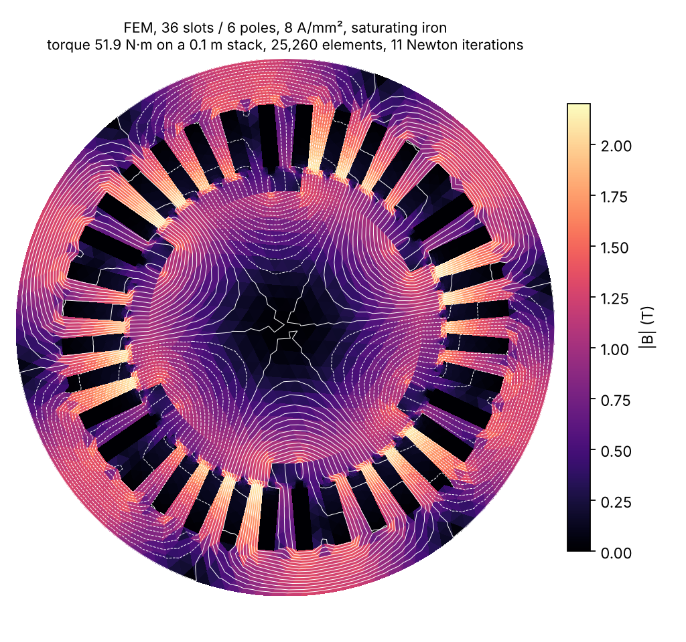
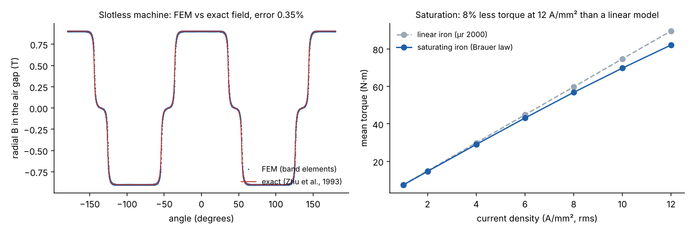
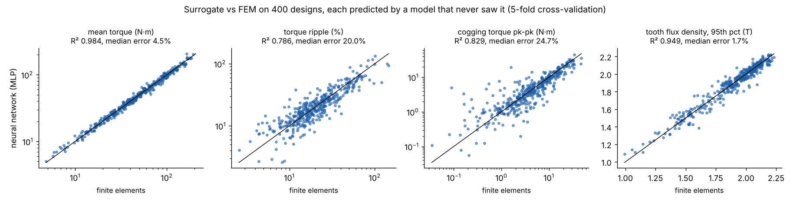
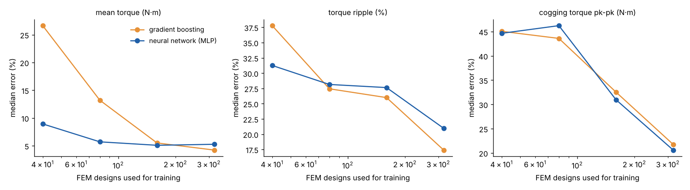
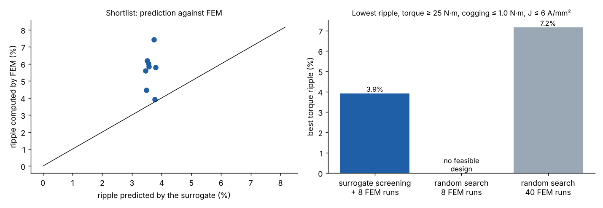

# Neural surrogate for electric machine design, trained on finite element simulations

[](https://github.com/kawtar-bellamine/motor-surrogate/actions/workflows/tests.yml)

Finite element simulation gives the torque, the torque ripple and the cogging torque of an electric machine, but
each design takes seconds to minutes, and exploring a design space needs thousands. This project:

1. writes a **2D magnetostatic finite element solver** for surface-mounted permanent magnet machines, with
   **saturating iron**, and **validates it against a published exact solution**;
2. runs it on **400 machine designs** (5,600 field solutions);
3. trains surrogates (linear model on physical groups, gradient boosting, neural network) and measures them by
   cross-validation;
4. uses the best one to **screen 100,000 candidate designs in 0.1 s and verify the shortlist by FEM**.



## The finite element model

[`motorsur/fem.py`](motorsur/fem.py): geometry and mesh with **gmsh** (rotor, radially magnetised magnets, air gap,
stator with Q parallel slots, three-phase single-layer winding); magnetic vector potential A_z on first-order
triangles assembled with NumPy and SciPy; magnets as remanent sources (B = µ0 µr H + Br); iron with **Brauer's
reluctivity law** ν(B) = k1 exp(k2 B²) + k3 (initial µr about 2,000, saturating above 1.6 T); **Newton-Raphson**
iterations with a line search on the magnetic energy; torque by **Arkkio's method** (Maxwell stress averaged over an
annulus in the air gap). Rotor re-meshed at each position. Per design: cogging torque over one cogging period (8
positions, no current) and torque under load over one sixth of an electrical period (6 positions, currents on the q
axis plus an angle ψ).

### How far it can be trusted ([`results/validation.json`](results/validation.json))

| Check | Result |
|---|---|
| Slotless machine, air-gap field against the **exact solution of Zhu, Howe, Bolte and Ackermann (IEEE Trans. Magn., 1993)** | **0.35% error** (0.83% with elements twice larger); torque 10⁻⁶ N·m, as it should be zero |
| The exact solution itself: subdomain linear system written from scratch against the paper's closed form | identical to 10⁻⁹ (test) |
| Mesh convergence, 4 slotted designs, air-gap elements halved | mean torque within 0.2%, ripple within 1.5%, cogging within 8% |
| Cogging with 8 rotor positions against 24 | within 1.4% |
| Maximum torque at ψ = 0 (current on the q axis) for every slot/pole combination | yes (test) |



Cogging is the most mesh-sensitive quantity (up to 8% between the two meshes): it is a small difference of large
forces at the slot openings. The surrogate's cogging errors below must be read against that.

## Data

400 designs sampled over 11 inputs: 8 slot/pole combinations with an integer number of slots per pole and phase
(12/4 to 48/16), magnet radius 30 to 60 mm, air gap 0.5 to 1.5 mm, magnet thickness 2 to 6 mm, pole-arc ratio 0.6 to
0.95, slot opening 10% to 50% of the slot pitch, tooth width 35% to 65%, remanence 1.1 to 1.3 T, current density
2 to 12 A/mm² rms, current angle ±30°. Stack length 0.1 m (2D: torque is proportional to it). Four outputs: mean
torque, torque ripple, cogging torque peak to peak, tooth flux density (95th percentile, the saturation level). Mean
FEM time: **18 s per design** on one CPU core. All rows: [`data/designs_fem.csv`](data/designs_fem.csv), with the
torque curves.

## Findings

1. **On a few hundred FEM runs, physics in the features beats depth in the model.** With the sizing equation of
   electrical machines as a feature (T ≈ π R² L B1 A1 cos ψ, in logarithm), a linear model predicts the mean torque
   within **3.0%** (median, R² 0.985); without it, 12% on a held-out split. Five-fold cross-validation, every design predicted by a model
   that never saw it:

   | Median error (R²) | Mean torque | Torque ripple | Cogging | Tooth flux density |
   |---|---|---|---|---|
   | Linear model on physical groups (log) | **3.0%** (0.985) | 21.8% (0.65) | 30.5% (0.75) | 3.1% (0.84) |
   | k nearest neighbours | 19.9% (0.82) | 29.1% (0.39) | 46.0% (0.47) | 3.8% (0.77) |
   | Gradient boosting | 3.7% (0.980) | **19.3%** (0.70) | 25.4% (0.83) | 2.5% (0.83) |
   | **Neural network (3 x 96, SiLU)** | 4.5% (0.984) | 20.0% (**0.79**) | **24.7%** (**0.83**) | **1.7%** (**0.95**) |

   

2. **Ripple and cogging are hard, and real FEM shows it.** They come from the interaction of slot and magnet
   harmonics and change quickly with the geometry: a 20% to 25% median error with 320 training designs. Features that
   describe cogging physically (LCM of slots and poles, where the magnet edges fall relative to the slots) brought
   the cogging error from 43% to 25%. The learning curve is still falling at 320 designs: more FEM runs would help.

   

3. **A prediction costs 15 million times less than an FEM run**: 0.001 ms per design in batch against 18 s.

4. **Screen with the surrogate, decide with FEM.** Target: torque ≥ 25 N·m, cogging ≤ 1 N·m, magnet radius ≤ 45 mm,
   current density ≤ 6 A/mm² (natural cooling), lowest ripple. The surrogate screens 100,000 candidates in 0.08 s and
   sends 8 to FEM: **all 8 meet the constraints, the best has a ripple of 3.9%** (36 slots, 4 poles, 28.3 N·m, cogging
   0.51 N·m). The same 8 FEM runs on random candidates find no feasible design; 40 runs find 5, the best at 7.2%.
   On the shortlist, predicted torque is within 16% of FEM (median 7%), and predicted ripple is always optimistic
   (3.5% to 3.8% predicted, 3.9% to 7.4% computed): the search picks the designs where the model errs low, so the
   final choice stays with FEM.

   

5. **The first version of this project was wrong where it mattered.** Its simulator was semi-analytical (air-gap
   permeance x MMF, linear iron). Against FEM on 60 of the same designs: torque 14% too high (median), ripple and
   cogging off by 54% and 49%. A surrogate is only as good as the simulations it learns from.

6. **Saturation costs torque at high current.** On a 36-slot, 6-pole machine, saturating iron gives 8% less torque
   than linear iron at 12 A/mm² (82 against 90 N·m); the tooth flux density is the output the network predicts best
   (1.7%), which makes it a usable constraint during screening.

All numbers: [`results/metrics.json`](results/metrics.json), [`results/validation.json`](results/validation.json).

## Run it

```bash
pip install -r requirements.txt
./run_all.sh        # 400 FEM designs (about 1 hour on 2 cores, resumable), validation, training, screening, figures
pytest -q           # includes FEM against the exact solution (about 40 s)
```

## Limits and next steps

- 2D, no end effects; one B-H law (Brauer, M19-like steel); no eddy currents or iron losses.
- The features were chosen while looking at a split of the first 260 designs; the cross-validation covers all 400,
  so the errors above are slightly optimistic.
- Next: active learning (run FEM where an ensemble of surrogates disagrees most) and back-EMF and force-wave outputs
  for noise.

Kawtar Bellamine, 2026.
